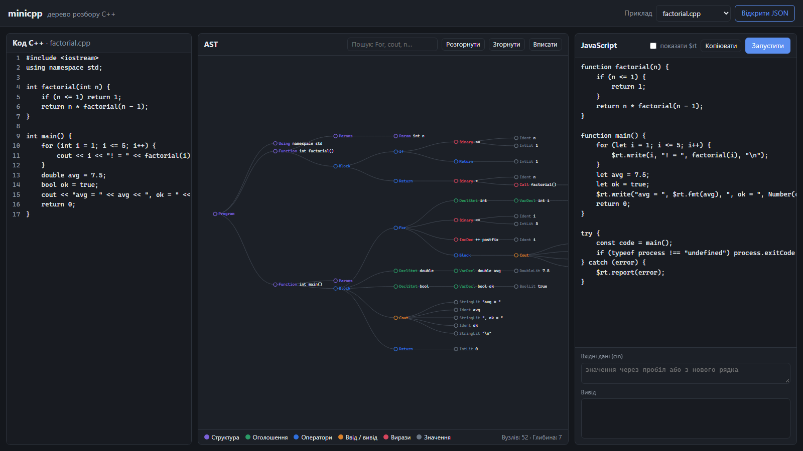

# minicpp: синтаксичний аналізатор підмножини C++ на flex/bison

Лабораторна робота №3 з системного програмування.

`minicpp` розбирає програми на підмножині мови C++, будує абстрактне синтаксичне дерево (AST), перевіряє семантику, виконує програму (інтерпретатор), перекладає її на JavaScript і показує дерево у браузері (React + d3.js).



## Можливості

| Що | Як запустити |
|---|---|
| Лексичний аналіз (flex), таблиця токенів | `minicpp.exe file.cpp --tokens` |
| Синтаксичний аналіз (bison, LALR(1)), помилки з номером рядка | `minicpp.exe file.cpp` |
| Побудова AST і друк дерева в консоль | `minicpp.exe file.cpp --ast` |
| Експорт AST у JSON | `minicpp.exe file.cpp --json ast.json` |
| Семантичний аналіз: області видимості, типи, виклики | виконується завжди після розбору |
| Інтерпретація (обчислення по AST) | `minicpp.exe file.cpp --run` |
| Трансляція C++ → JavaScript | `minicpp.exe file.cpp --js out.js` |
| Код + AST + JS одним файлом для веба | `minicpp.exe file.cpp --bundle out.json` |
| Візуалізація AST у браузері | `web/` (див. нижче) |

Опції можна поєднувати, наприклад `minicpp.exe file.cpp --ast --run`.

## Збірка

Потрібні g++ (C++17), GNU Make, flex і bison. На Windows усе ставиться через [MSYS2](https://www.msys2.org/):

```
pacman -S mingw-w64-ucrt-x86_64-gcc make flex bison
```

```
build.bat                 збірка
build.bat test            тести (потрібен Node.js)
build.bat web             оновити приклади для веба (web/src/examples.json)
build.bat conflict-demo   показати конфлікт dangling else
build.bat clean           видалити згенеровані файли
```

`build.bat` додає `C:\msys64\ucrt64\bin` і `C:\msys64\usr\bin` у PATH і викликає `make`. На Linux/macOS — просто `make`, `make test` і т.д.

## Візуалізація (React + Vite + d3.js)

```
cd web
npm install
npm run dev
```

і відкрити http://localhost:5173. Готову статичну версію збирає `npm run build` (папка `web/dist`).

- дерево AST з кольорами за категоріями вузлів, масштабуванням і перетягуванням;
- клік по вузлу згортає/розгортає гілку і підсвічує його рядок у коді, клік по рядку коду підсвічує вузли цього рядка;
- пошук вузлів за типом або текстом (`For`, `cout`, `n`);
- згенерований JavaScript, кнопка «Запустити» з полем для `cin` (код виконується у Web Worker з тайм-аутом 5 с);
- «Відкрити JSON» або перетягування файлу, створеного `--bundle` (або просто AST з `--json`).

Структура: `src/App.jsx` — сторінка і вибір прикладу, `src/components/` — три панелі, `src/tree.js` — малювання дерева через d3, `src/runner.js` + `src/run.worker.js` — запуск JS.

## Підтримувана мова

```cpp
#include <iostream>
using namespace std;

int factorial(int n) {
    if (n <= 1) return 1;
    return n * factorial(n - 1);
}

int main() {
    for (int i = 1; i <= 5; i++) {
        cout << i << "! = " << factorial(i) << endl;
    }
    return 0;
}
```

- типи: `int`, `double`, `bool`, `string`, `void`
- глобальні й локальні змінні, кілька змінних в одному оголошенні: `int a = 0, b = 1;`
- функції з параметрами, рекурсія
- `if` / `else`, `while`, `for`, `break`, `continue`, `return`, блоки `{ }`
- оператори: `+ - * / %`, `== != < > <= >=`, `&& || !`, унарні `- +`, `= += -= *= /=`, `++ --`
- ввід і вивід: `cout << ... << endl;`, `cin >> a >> b;` (також з `std::`)
- коментарі `//` і `/* */`, рядки `#include` пропускаються

### Граматика (скорочено)

```
program     : top_item*
top_item    : "using" "namespace" IDENT ";" | func_def | var_decl
func_def    : type IDENT "(" params? ")" block
var_decl    : type var_init ("," var_init)* ";"
var_init    : IDENT ("=" expr)?
block       : "{" stmt* "}"
stmt        : var_decl | expr ";" | ";" | block | if_stmt | while_stmt | for_stmt
            | "return" expr? ";" | "break" ";" | "continue" ";"
            | "cout" ("<<" (expr | "endl"))+ ";" | "cin" (">>" IDENT)+ ";"
if_stmt     : "if" "(" expr ")" stmt ("else" stmt)?
while_stmt  : "while" "(" expr ")" stmt
for_stmt    : "for" "(" (var_decl | expr? ";") expr? ";" expr? ")" stmt
expr        : IDENT assign_op expr
            | expr op expr | ("!" | "-" | "+") expr | ("++" | "--") IDENT | IDENT ("++" | "--")
            | INT | DOUBLE | STRING | "true" | "false" | IDENT | IDENT "(" args? ")" | "(" expr ")"
assign_op   : "=" | "+=" | "-=" | "*=" | "/="
```

Повна граматика: [src/parser.y](src/parser.y). Пріоритети операторів (від найнижчого):

| Пріоритет | Оператори | Асоціативність |
|---|---|---|
| 1 | `= += -= *= /=` | права |
| 2 | `\|\|` | ліва |
| 3 | `&&` | ліва |
| 4 | `== !=` | ліва |
| 5 | `< > <= >=` | ліва |
| 6 | `+ -` | ліва |
| 7 | `* / %` | ліва |
| 8 | `!`, унарні `- +` | права |

Граматика збирається без конфліктів (`%expect 0`): 95 правил, 164 стани LALR-автомата (опис станів — `build/parser.output`). Конфлікт «dangling else» знімається через `%prec LOWER_THAN_ELSE`: `else` прив'язується до найближчого `if`. `build.bat conflict-demo` показує, що без `%prec` bison знаходить рівно 1 shift/reduce конфлікт.

## Як це працює

```
текст .cpp ──► лексер (flex) ──► токени ──► парсер (bison) ──► AST
                                                                │
                      ┌───────────────┬───────────────┬─────────┴───────┐
                      ▼               ▼               ▼                 ▼
               семантичний      інтерпретатор    генератор JS      JSON для веба
                 аналіз            (--run)          (--js)        (--json, --bundle)
```

1. **Лексер** ([src/lexer.l](src/lexer.l)) перетворює текст на потік токенів за регулярними виразами.
2. **Парсер** ([src/parser.y](src/parser.y)) перевіряє, що токени утворюють правильну програму, і в діях правил будує вузли дерева. Після синтаксичної помилки розбір продовжується з наступного `;` (правило `stmt : error ';'`).
3. **AST** ([src/ast.hpp](src/ast.hpp), [src/ast.cpp](src/ast.cpp)): кожен вузол має тип (`NodeKind`), рядок у коді, ім'я або оператор і список дітей.
4. **Семантичний аналіз** ([src/semantic.cpp](src/semantic.cpp)) обходить дерево зі стеком областей видимості і знаходить: неоголошені й повторно оголошені змінні, несумісні типи, неправильну кількість/тип аргументів, `return` не того типу, `break`/`continue` поза циклом, відсутність `main`.
5. **Інтерпретатор** ([src/interpreter.cpp](src/interpreter.cpp)) обходить те саме дерево й обчислює значення. Цілочисельне ділення, перетворення типів і формат виводу `double` відповідають C++.
6. **Генератор JavaScript** ([src/codegen_js.cpp](src/codegen_js.cpp)) теж обходить дерево, але пише код. Враховує різницю між мовами: ділення `int` стає `Math.trunc`, `bool` при виводі друкується як `1`/`0`, імена, зарезервовані в JS (`let`, `var`, ...), отримують суфікс `$`.

## Приклади

| Файл | Що показує |
|---|---|
| [factorial.cpp](examples/factorial.cpp) | рекурсія, `for`, `cout` |
| [primes.cpp](examples/primes.cpp) | `while (true)`, `break`, `%`, `+=` |
| [types.cpp](examples/types.cpp) | цілочисельне ділення, перетворення типів, `string`, `++`, `else if`, `continue` |
| [input.cpp](examples/input.cpp) | `cin`, рядки (вхідні дані — [input.in](examples/input.in)) |
| [dangling_else.cpp](examples/dangling_else.cpp) | вкладені `if` з одним `else` |
| [syntax_error.cpp](examples/syntax_error.cpp) | дві синтаксичні помилки, відновлення після помилки |
| [semantic_error.cpp](examples/semantic_error.cpp) | шість семантичних помилок |

## Тести

`build.bat test` запускає [tests/run_tests.sh](tests/run_tests.sh):

- для кожного правильного прикладу порівнює вивід інтерпретатора, згенерованого JavaScript (`node`) і тієї самої програми, скомпільованої справжнім `g++`;
- перевіряє лексичну, синтаксичну, семантичну помилку і ділення на нуль під час виконання;
- перевіряє кількість токенів і те, що без `%prec` граматика має рівно один shift/reduce конфлікт.

## Структура

```
src/lexer.l         лексер (flex)
src/parser.y        граматика і побудова AST (bison)
src/ast.*           вузли дерева, друк, JSON
src/semantic.*      семантичний аналіз
src/interpreter.*   інтерпретатор
src/codegen_js.*    генерація JavaScript
src/main.cpp        аргументи командного рядка
web/                візуалізація (React + Vite + d3.js)
examples/           приклади програм
tests/              тести
```
